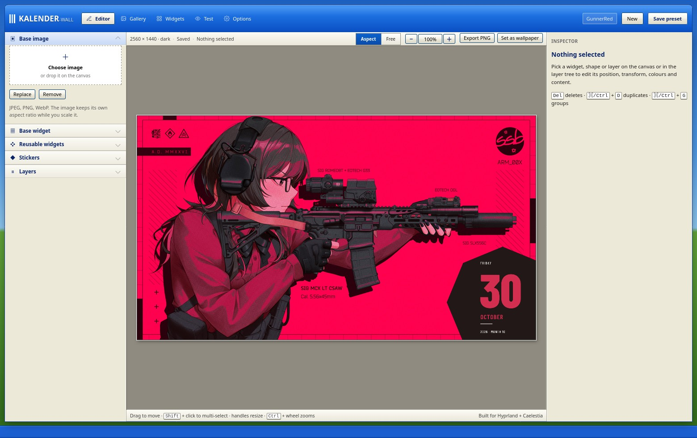
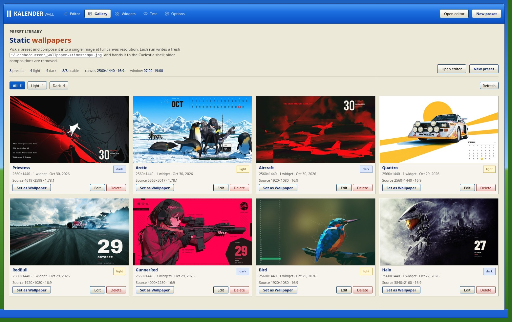
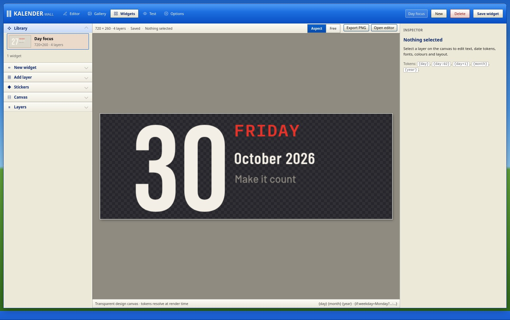
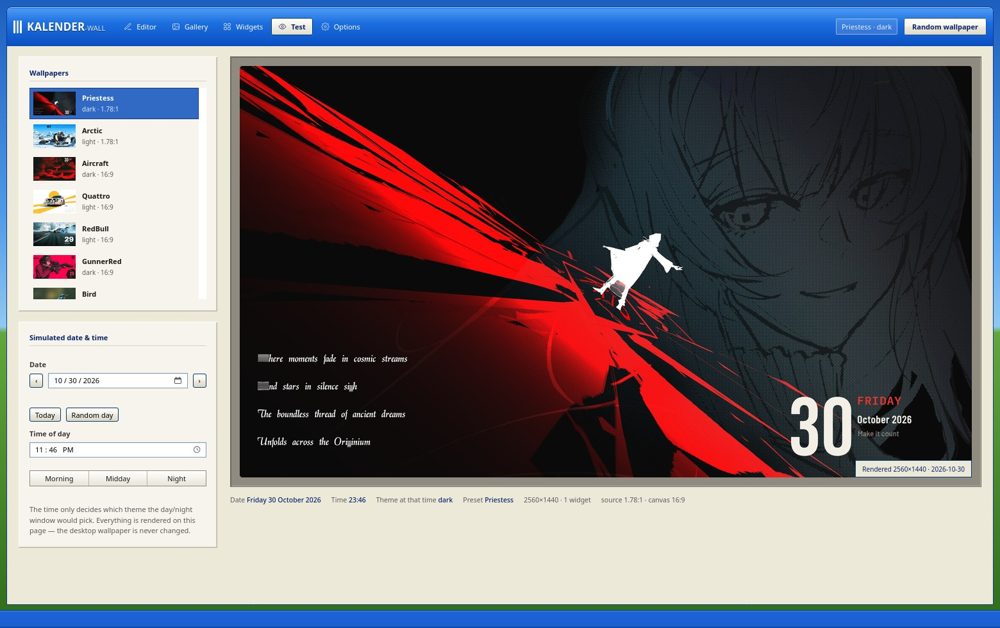
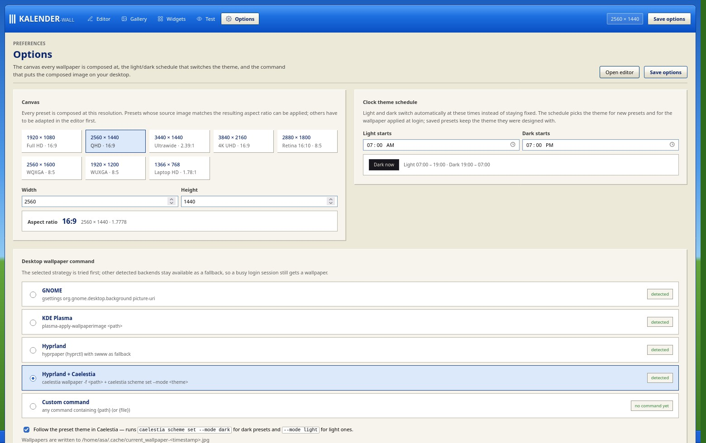

# Kalender-Wall

**Static calendar wallpapers for Hyprland + Caelestia, with a retro web editor.**

Kalender-Wall composes a base image and freely arranged widgets — text, calendars,
stickers and vector shapes — into a single image **at the exact resolution of your
canvas**, puts it on the desktop, and can pick a light or dark preset automatically
at login.



No daemon, no live widget runtime, no build step: the wallpaper is rendered once and
handed to the compositor, so it costs nothing while you work.

---

## Contents

- [Features](#features)
- [Requirements](#requirements)
- [Installing](#installing)
- [Running the web UI](#running-the-web-ui)
- [The five pages](#the-five-pages)
- [Editor guide](#editor-guide)
- [Presets and ratios](#presets-and-ratios)
- [CLI](#cli)
- [Autostart](#autostart)
- [Caelestia integration](#caelestia-integration)
- [Configuration](#configuration)
- [Stickers and fonts](#stickers-and-fonts)
- [Troubleshooting](#troubleshooting)
- [Status](#status)
- [License](#license)

---

## Features

- **Web editor** (FastAPI + vanilla ES modules): drag, resize, rotate and style
  layers while previewing the exact pixels the compositor will produce.
- **Calendars that fit either screen edge** — month grid, strip, minimal, horizontal
  strip, and a vertical one-column grid in a *left* and *right* variant, with an
  adjustable gap between the day numbers and the weekday labels.
- **Free transform** — an *Aspect* mode that scales layers proportionally and a
  *Free* mode that changes width and height independently, so a square really does
  become a rectangle.
- **Reusable widgets** — design a widget once on its own canvas (date tokens and
  rules included) and drop it into any preset as a single layer.
- **SVG shape library** — line, circle, square, triangle, pentagon, hexagon, octagon,
  5- and 8-point stars, heart, shield, starburst and speech bubble, all on one
  universal `0 0 100 100` viewBox with fill, stroke and stroke width.
- **Groups and vector masks** — group layers into one `<g>` object, or clip / punch
  a live hole with a shape.
- **Real ratios, not strings** — presets store the source image's pixel dimensions
  and the ratio is derived on the fly.
- **Day/night schedule** — light between 07:00 and 19:00 by default, configurable.
- **Caelestia aware** — applies the wallpaper *and* sets the shell's light/dark mode
  to match the preset.
- **Windows XP themed UI** — grey panels, beveled buttons and a blue title bar,
  because a static wallpaper tool has no business being sleek.

---

## Requirements

| | |
| --- | --- |
| **OS** | Linux with **Hyprland**; developed and tested against the [Caelestia](https://github.com/caelestia-dots) dotfiles |
| **Python** | 3.10 or newer |
| **Python packages** | `fastapi`, `uvicorn`, `pillow`, `python-multipart`, `cairosvg` (installed below) |
| **System library** | `cairo` — needed by cairosvg to rasterise SVG stickers and shapes |
| **Wallpaper backend** | `caelestia` (default), `hyprpaper`, `swww`, KDE Plasma, GNOME or a custom command |
| **Browser** | Any modern browser for the editor (Firefox or Chromium) |

```bash
# Arch
sudo pacman -S python uv cairo

# Debian / Ubuntu
sudo apt install python3 python3-venv libcairo2
```

---

## Installing

```bash
git clone https://github.com/ariefansori/kalender-wall.git ~/Projects/kalender-wall
cd ~/Projects/kalender-wall
```

### With uv (recommended)

```bash
uv sync
.venv/bin/hyprwall doctor
```

### With plain Python

```bash
python3 -m venv .venv
.venv/bin/pip install -r requirements.txt
.venv/bin/python -m hyprwall doctor
```

`uv sync` installs a `hyprwall` console script into `.venv/bin/`; with pip you can
either call `.venv/bin/python -m hyprwall …` or install the project itself with
`.venv/bin/pip install -e .`

Either way the **command is still called `hyprwall`** — the package name predates the
Kalender-Wall name and keeping it means existing scripts and autostart entries keep
working.

`doctor` prints what it found:

```
Kalender-Wall 1.0.0
  python          3.14.8
  pillow          13.0.0
  presets dir     ~/Projects/kalender-wall/presets (8 presets, 4 light / 4 dark)
  canvas          2560×1440 (16:9), 8 preset(s) match
  widgets dir     ~/Projects/kalender-wall/widgets (1 reusable widgets)
  output          ~/.cache/current_wallpaper-<timestamp>.jpg (writable)
  config          defaults (no ~/.config/hyprwall/config.json)
  theme window    07:00–19:00 (now: dark)
  session         Hyprland, WAYLAND_DISPLAY=wayland-1
  selected        hyprland-caelestia
  apply backends  hyprland-caelestia, hyprland, kde, gnome
  caelestia smart off (passes -N)
  caelestia mode  follows the preset (`caelestia scheme set --mode light|dark`)
```

### First wallpaper

```bash
.venv/bin/hyprwall apply --dry-run   # what would happen, changes nothing
.venv/bin/hyprwall apply             # render + apply right now
```

---

## Running the web UI

```bash
.venv/bin/hyprwall serve              # http://127.0.0.1:8787
.venv/bin/hyprwall serve --reload     # development: reload on code changes
.venv/bin/hyprwall serve --port 9000  # somewhere else
```

The server binds `127.0.0.1` by default. Nothing is sent to the network: the editor
talks to the local FastAPI process, which writes the wallpaper into
`~/.cache/`.

---

## The five pages

Every page is generated from one shared header (`web/js/nav.js`), so the menu is
always complete and each entry always carries the same icon.

### Editor — `/`

Where presets are built. Base image on the canvas, widgets on top, layer tree on the
left, inspector on the right.


### Gallery — `/gallery`

Every saved preset as a thumbnail with its resolution, source ratio, theme and
widget count. Filter by theme or ratio, apply a preset, edit it, or delete it.



### Widgets — `/widgets`

A smaller editor with its own canvas for reusable widgets: text with date tokens,
calendars, shapes, stickers, groups and masks. Saved widgets appear in the editor's
**Reusable widgets** panel and drop in as a single layer.



### Test — `/test`

Renders any preset for a simulated date and time and shows which theme the schedule
would pick. The desktop is never touched, so it is the safe way to check a preset —
including what a calendar will look like on the 1st of next month.



### Options — `/options`

Canvas size (common presets or any custom width × height), the light/dark schedule,
and the desktop wallpaper command, including the Caelestia theme switch.



---

## Editor guide

1. **Base image** — choose a JPEG/PNG/WebP or drop it on the canvas. The untouched
   upload is kept as `original-image.<ext>`; the cropped, downscaled result becomes
   `base.jpg`.
2. **Add widgets** (unlocked once a base image exists):
   - **Text** — content, font, weight, size, colour, alignment, line height, letter
     spacing, uppercase, and date tokens such as `{day}` or `{month:upper}`.
   - **Calendar** — `grid`, `strip` or `minimal`, in one of four layouts.
   - **Stickers** — images from `assets/stickers/`, transform only.
   - **Shapes** — the built-in vector library with fill, stroke and stroke width.
   - **Reusable widgets** — anything from the Widgets page.
3. **Arrange** — drag to move, eight handles to resize, the round handle to rotate
   (`Shift` snaps to 15°), arrows to nudge (`Shift` = 10 px), `Ctrl/⌘` + wheel to
   zoom. Handles live in an unclipped overlay, so they stay reachable even when a
   layer hangs off the canvas.
4. **Save preset** — pick a name and a theme. Files land in `presets/<slug>/`.
5. **Set as wallpaper** — composites at full canvas resolution, writes a fresh
   `~/.cache/current_wallpaper-<timestamp>.jpg`, calls the desktop command and deletes
   the composition it replaced.

### Aspect vs. Free transform

The **Aspect / Free** switch in the stage toolbar decides what the handles do:

| mode | what a handle does | use it for |
| --- | --- | --- |
| **Aspect** (default) | one factor is applied to both sides, so the layer keeps its proportions | scaling text, icons, photos without distortion |
| **Free** | width and height change independently — the box *and* its contents stretch | stretched calendars, banners, turning a square into a rectangle |

Both modes get all eight grips. The choice is remembered in `localStorage`, and it
applies to the base image too: in Free mode the base box changes aspect, which is how
you re-crop a photo to a new ratio.

### Calendar layouts

| layout | shape | placement |
| --- | --- | --- |
| `auto` | follows the style's design space | anywhere |
| `horizontal` | one row of 31 days | bottom or top edge |
| `vertical` | one column, day numbers on the **left** | left screen edge |
| `vertical-right` | mirrored, day numbers on the **right** | right screen edge |

Both vertical layouts accept a **Number ↔ day gap** (`gap`, 0–260 design px) that
pulls the weekday labels towards the day numbers. The numbers stay pinned to the
outer edge, so `0` puts the labels on the inner edge and larger values tighten the
block. The same value is honoured by the browser preview and the Pillow compositor.

---

## Presets and ratios

A preset is a folder:

```
presets/gunnerred/
├── base.jpg              # cropped + downscaled source (never larger than the canvas)
├── original-image.jpg    # untouched upload (optional)
└── widget.json           # canvas, base placement, theme, layers
```

Nothing stores a `"16:9"` string. A preset records the real pixel size of the image it
was built from (`sourceWidth` / `sourceHeight`) and the ratio is derived on the fly,
compared numerically with a **1.5 % tolerance**.

- **Matching presets** can be applied from the gallery, the editor or the CLI.
- **Mismatched presets cannot be applied.** The gallery shows a ratio badge and offers
  *Edit*, the editor disables *Set as wallpaper*, and the CLI refuses a mismatched
  preset by name.
- To use one anyway, open it in the editor, press **Adapt to canvas** (the banner
  appears automatically) and save it as a **new** preset. The original is untouched.
- The final wallpaper is always rendered at the current canvas size, so the base
  image, the previews and the desktop share one ratio.

Eight presets ship with the project — RedBull, Quattro, Bird, Arctic (light) and
Aircraft, Halo, Priestess, GunnerRed (dark) — each a designed composition over a
photographic base. GunnerRed is the multi-layer reference: a sticker, an octagon shape
and a minimal calendar as three separate layers.

---

## CLI

```bash
hyprwall apply                        # random preset for the current time of day
hyprwall apply --preset gunnerred     # by slug or display name
hyprwall apply --time 21:30           # pretend it is 9:30 pm
hyprwall apply --theme light          # force a theme
hyprwall apply --no-apply             # render only
hyprwall apply --dry-run              # print the plan, change nothing
hyprwall apply --retry 5 --retry-delay 2   # wait for the compositor at login
hyprwall apply --quiet                # nothing but errors
hyprwall list [--theme dark] [--json]
hyprwall doctor
hyprwall serve [--host H] [--port P] [--reload]
```

`apply` only picks presets whose ratio matches the canvas, renders at
`canvas.width × canvas.height`, and then tries the **selected backend first** and the
other detected ones as fallbacks (`hyprland-caelestia` → `hyprland` → `kde` → `gnome`
→ `custom`). It never leaves you without a wallpaper just because `swww` is missing.

`--dry-run` prints the exact command chain, which is the quickest way to see what
Caelestia integration actually runs:

```
[hyprwall]   Caelestia shell: /usr/bin/caelestia wallpaper -N -f ~/.cache/current_wallpaper-20261030-233729.jpg \
             && /usr/bin/caelestia scheme set --mode dark
```

---

## Autostart

### Caelestia (Lua dotfiles)

Add this to `~/.config/caelestia/hypr-user.lua`, adjusting the path:

```lua
hl.on("hyprland.start", function()
    hl.exec_cmd("sleep 3 && /home/<USERNAME>/Projects/kalender-wall/.venv/bin/hyprwall apply --retry 5 --retry-delay 2 --quiet")
end)
```

### Classic `hyprland.conf`

```conf
exec-once = /home/<USERNAME>/Projects/kalender-wall/.venv/bin/hyprwall apply --retry 5 --retry-delay 2 --quiet
```

The `sleep` and `--retry` are there because the compositor needs a moment before it
accepts a wallpaper. To keep a log instead of silence:

```conf
exec-once = /home/<USERNAME>/Projects/kalender-wall/.venv/bin/hyprwall apply --retry 12 --retry-delay 2 >> ~/.cache/hyprwall/autostart.log 2>&1
```

Test it without logging out:

```bash
.venv/bin/hyprwall apply --dry-run
.venv/bin/hyprwall apply
```

By default the preset is chosen from the day/night schedule (07:00–19:00 light,
otherwise dark). Use `hyprwall apply --theme dark` in the command if you always want
the same mood, or a timer to re-run `hyprwall apply` at sunrise and sunset.

---

## Caelestia integration

Caelestia draws wallpapers itself through Quickshell, so the backend is:

```bash
caelestia wallpaper -N -f ~/.cache/current_wallpaper-<timestamp>.jpg
caelestia scheme set --mode dark      # dark preset
caelestia scheme set --mode light     # light preset
```

The second command keeps the shell's colour scheme in step with the preset:
applying a dark preset also puts Caelestia in dark mode, applying a light one puts it
in light mode. A fresh timestamped filename is used for every render because Caelestia
caches by path.

Both steps are controlled from **Options → Desktop wallpaper command**:

- **Follow the preset theme in Caelestia** (`wallpaper.caelestiaScheme`, on by
  default) — runs `caelestia scheme set --mode …` after the wallpaper. Turn it off if
  you manage the shell's mode yourself.
- `-N` keeps `caelestia wallpaper` from deriving its own scheme from the image. Set
  `wallpaper.caelestiaSmartScheme` to `true` if you'd rather it did.

If the scheme command fails (an older Caelestia without `scheme set`), the wallpaper
still applies and the failure is reported as a warning rather than a failed apply, so
you are never left with a stale wallpaper because of a colour mode.

---

## Configuration

`~/.config/hyprwall/config.json` — every key is optional; the Options page writes
`canvas`, `theme` and `wallpaper` and leaves the rest alone.

```json
{
  "presetsDir": "~/Projects/kalender-wall/presets",
  "widgetsDir": "~/Projects/kalender-wall/widgets",
  "cacheDir": "~/.cache/hyprwall",
  "outputPath": "~/.cache/current_wallpaper.jpg",
  "theme": { "dayStart": "07:00", "dayEnd": "19:00" },
  "canvas": { "width": 2560, "height": 1440, "background": "#101014" },
  "clockTheme": "dark",
  "wallpaper": {
    "backend": "hyprland-caelestia",
    "applyCommand": null,
    "caelestiaSmartScheme": false,
    "caelestiaScheme": true
  }
}
```

| key | meaning |
| --- | --- |
| `presetsDir` / `widgetsDir` | where presets and reusable widgets live (must be writable by the web UI) |
| `cacheDir` | uploads, thumbnails and CLI state |
| `outputPath` | base name for the composed wallpaper; a `-YYYYmmdd-HHMMSS` stamp is inserted before the suffix, or add `{timestamp}` yourself |
| `theme.dayStart` / `theme.dayEnd` | light window; may wrap over midnight |
| `canvas` | the resolution every wallpaper is generated at |
| `clockTheme` | fallback single theme for clients that don't read the schedule |
| `wallpaper.backend` | `hyprland-caelestia`, `hyprland`, `kde`, `gnome` or `custom` |
| `wallpaper.applyCommand` | your own command containing `{path}` (or `{file}`) for `custom` |
| `wallpaper.caelestiaScheme` | run `caelestia scheme set --mode …` after applying |
| `wallpaper.caelestiaSmartScheme` | let `caelestia wallpaper` pick a scheme from the image |

Environment overrides: `HYPRWALL_PRESETS_DIR`, `HYPRWALL_WIDGETS_DIR`,
`HYPRWALL_CACHE_DIR`, `HYPRWALL_OUTPUT`, `HYPRWALL_APPLY_COMMAND`,
`HYPRWALL_DAY_START`, `HYPRWALL_DAY_END`, `HYPRWALL_CONFIG`.

### Date tokens

Text layers expand tokens at render time: `{day}`, `{day_padded}`, `{month}`,
`{month_short}`, `{month_upper}`, `{month_number}`, `{weekday}`, `{weekday_short}`,
`{year}`, `{date}`. Add an offset (`{day+1}`, `{month-1}`) or a format
(`{day:02}`, `{month:upper}`, `{year:short}`), and conditionals such as
`{if:weekday=Saturday?Weekend:Work day}`. Unknown tokens are left as written. The
browser and the compositor share one grammar, so previews match the final image.

---

## Stickers and fonts

- Drop PNG / WebP / JPEG / GIF / SVG files into `assets/stickers/` and reload the
  editor. Only bare filenames from that folder are accepted.
- Stickers are transform-only: position, scale, rotation. With **Aspect** they keep
  their proportions; with **Free** they stretch into the box, exactly like shapes.
- Fonts are auto-detected: drop `.ttf` / `.otf` files into `assets/fonts/` (root or a
  subfolder) and reload. Family name and weight are read from the file's metadata, so
  the picker and both renderers use the same file.
- Bundled families (SIL Open Font License, licences in `assets/fonts/*/OFL.txt`):
  Barlow, Barlow Condensed, Bebas Neue, Archivo Black, IBM Plex Mono, plus Aktura,
  Array, Styro and Zina.

---

## Troubleshooting

| symptom | fix |
| --- | --- |
| *"does not match the canvas ratio"* | Open the preset, **Adapt to canvas**, save as a new preset — or change the canvas in **Options**. |
| *"A custom wallpaper command is required"* | The `custom` backend needs a command containing `{path}`. |
| Wallpaper did not change | `hyprwall doctor`, then `hyprwall apply --dry-run`. Caelestia caches by path, which is why every render uses a new timestamped file. |
| Caelestia stays in the wrong mode | Check **Options → Follow the preset theme in Caelestia**; `hyprwall apply --dry-run` shows whether the `scheme set` step is included. |
| Stickers or shapes are blank in the final image | Install `cairo` (`sudo pacman -S cairo`). The browser preview does not need it. |
| Nothing applies at login | The compositor was not ready: keep the `sleep 3` and `--retry 5 --retry-delay 2` from the autostart snippet. |
| An upload is rejected | JPEG, PNG or WebP only, up to 40 MB. |
| A renamed preset's old link 404s | Intended: the folder follows the name. Use the new slug from the gallery. |

---

## Status

**Tested on Arch Linux with Hyprland and the Caelestia dotfiles only.** Caelestia is
the primary target — it is the backend that also gets the light/dark scheme switch.
The `hyprpaper` / `swww`, KDE, GNOME and custom backends are implemented and detected,
but have not been exercised as thoroughly; treat them as best effort and report what
breaks.

The editor needs a modern browser (ES modules, `canvas`, `dialog`, `:has()`). There is
no Node toolchain, no bundler and no runtime dependency on JavaScript frameworks.

---

## License

MIT for the code. Bundled fonts ship under the SIL Open Font License; see
`assets/fonts/*/OFL.txt`.
